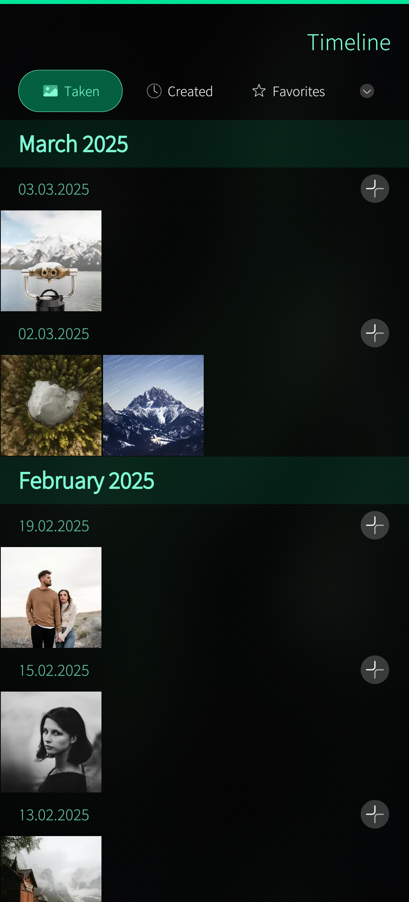
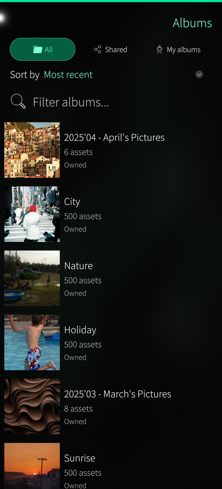
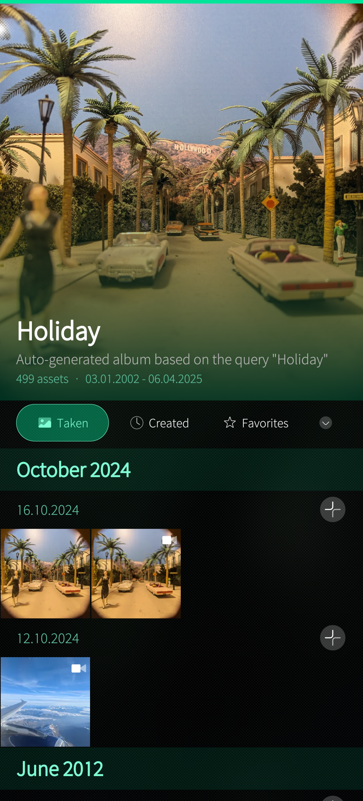
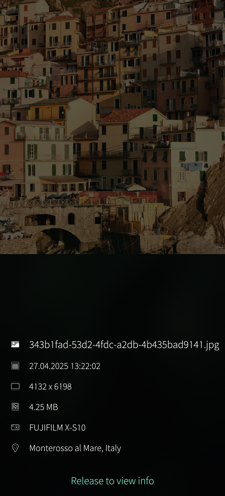
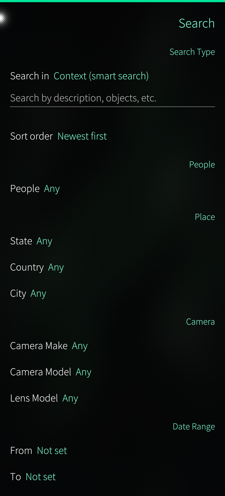
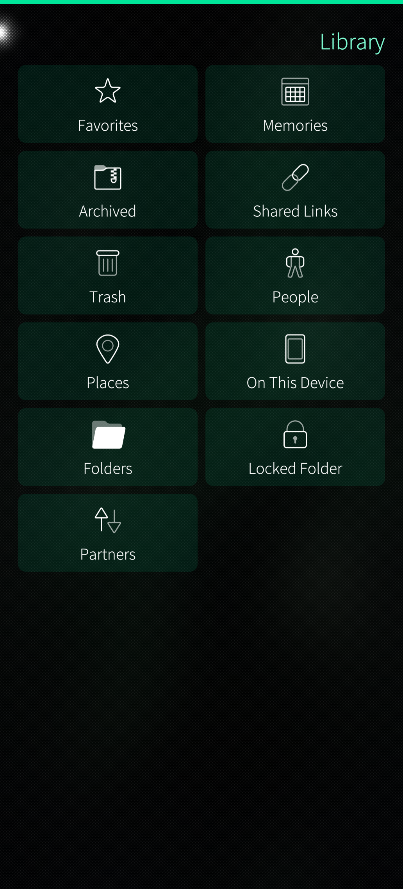
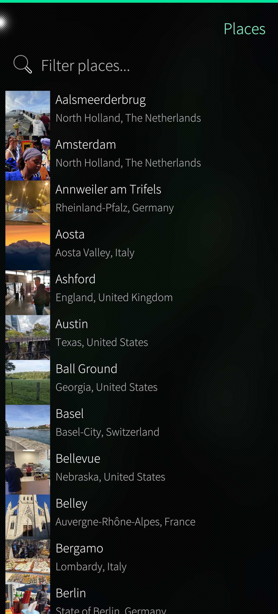
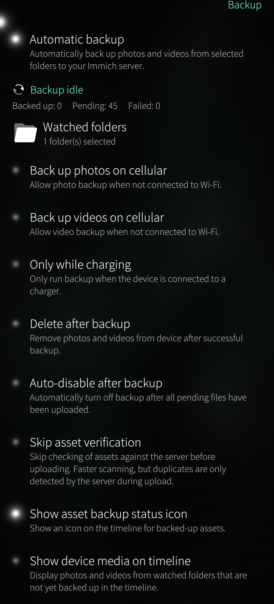

# Immich Client for Sailfish OS

A native Sailfish OS client for connecting to your self-hosted Immich server.

This application allows you to browse, manage, and interact with your Immich photo library directly from your Sailfish device.

---

## About Immich

This application connects to **Immich**, a high-performance self-hosted photo and video backup solution.

Immich provides:

- Automatic mobile backup
- AI-powered face recognition
- Object detection
- Smart search
- Shared albums
- Timeline view
- Multi-user support

Project website: https://immich.app

---

## Features

### Authentication
- Secure login to your Immich server
- Token-based session handling
- Support for self-hosted instances

### Photo & Video Browsing
- Timeline view
- Memories
- Album browsing
- Shared albums
- Thumbnail previews
- Full-resolution viewing

### Smart Search
- Search by date
- Search by location
- Search by people (if enabled on server)
- Metadata display (EXIF, location, etc.)

---

## Requirements

- Sailfish OS device
- Immich server (v3.x or newer recommended)
- Active user account on your Immich instance

---

## Installation

### From Harbour
Install directly via Jolla Harbour. Please note that due to the Jolla Harbour limitations OIDC login is disabled (if you require it install from other sources below).

### From Chum
Install directly from Chum.

### From OpenRepos
Install directly via Storeman.

### Manual Installation
Download the latest `.rpm` release and install via:

pkcon install-local harbour-immich-client.rpm

---

## Configuration

1. Launch the app
2. Enter your Immich server URL (e.g. `https://photos.example.com`)
3. Log in with your Immich credentials
4. Start browsing your library

---

## Screenshots

<table>
  <tr>
    <td width="33.33%" align="center">
      
    </td>
    <td width="33.33%" align="center">
      
    </td>
    <td width="33.33%" align="center">
      
    </td>
  </tr>
  <tr>
    <td width="33.33%" align="center">
      How default Timeline page where you land at after login looks like
    </td>
    <td width="33.33%" align="center">
      Albums page where you can browse and filter all your albums
    </td>
    <td width="33.33%" align="center">
      A detailed view of an album with all of its assets and hero images rotation
    </td>
  </tr>
  <tr>
    <td width="33.33%" align="center">
      
    </td>
    <td width="33.33%" align="center">
      
    </td>
    <td width="33.33%" align="center">
      
    </td>
  </tr>
  <tr>
    <td width="33.33%" align="center">
      Asset detail with available actions
    </td>
    <td width="33.33%" align="center">
      You can quickly display a brief information about asset when peeking from bottom or simply drag to open detailed info
    </td>
    <td width="33.33%" align="center">
      Search page with all available criteria to filter
    </td>
  </tr>
  <tr>
    <td width="33.33%" align="center">
      
    </td>
    <td width="33.33%" align="center">
      
    </td>
    <td width="33.33%" align="center">
      
    </td>
  </tr>
  <tr>
    <td width="33.33%" align="center">
      Library page where you can go to more details for each available category
    </td>
    <td width="33.33%" align="center">
      How for example Places page looks like when opened from Library
    </td>
    <td width="33.33%" align="center">
      Detailed backup settings
    </td>
  </tr>
</table>

---

## Contributing

Contributions, translations, and bug reports are welcome.

If you would like to help:

- Open an issue
- Submit a pull request
- Help with translations (https://hosted.weblate.org/projects/harbour-immich/harbour-immich)

---

## License

GPLv3

---

## Acknowledgements

- Immich project and contributors
- Sailfish OS community
- Frank Paul Silye (https://forum.sailfishos.org/u/frankps) - Norwegian translations and testing
- 247 (https://forum.sailfishos.org/u/247) - Italian translations
- Asulfr999 (https://forum.sailfishos.org/u/Asulfr999) - French translations
- nthn (https://forum.sailfishos.org/u/nthn) - Dutch translations
- xamino (https://forum.sailfishos.org/u/xamino) - German translations
- eson (https://forum.sailfishos.org/u/eson) - Swedish translations
- bittin  - Swedish translations
